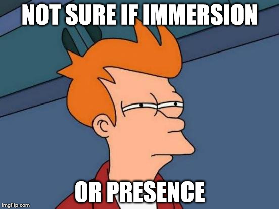
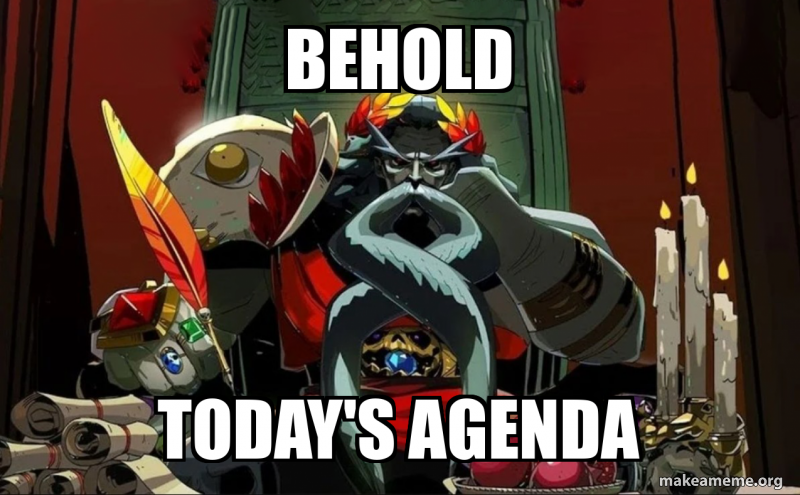
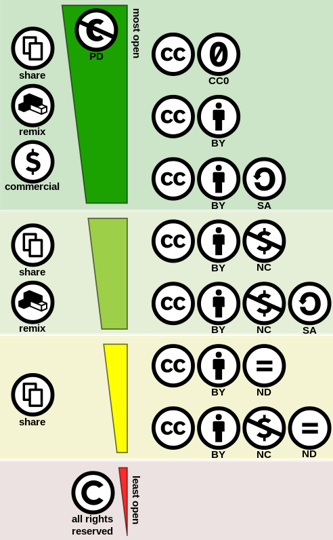

# Cours 8 – Installation interactive



## Ordre du jour



- [Feuille de suivi](#mise-a-jour-de-la-feuille-de-suivi)
- [Droits d'auteur et éthique](#droits-dauteur-et-ethique)
- [Installation interactive](#installation-interactive)
- [Évaluation : diffusion portant sur l'analyse des caractéristiques du domaine](#evaluation-diffusion-portant-sur-lanalyse-des-caracteristiques-du-domaine)

## Mise à jour de la feuille de suivi

Nous allons maintenant ajouter un de vos projets à la feuille de suivi. 

## Droits d'auteur et éthique

Toutes les œuvres que vous produisez vous appartiennent, à condition que vous déteniez les droits d'utilisation de vos ressources. Elles nécessitent votre autorisation pour être modifiées ou publiées.

Vos droits existent dès la création, mais il est plus facile de les prouver si l'œuvre est marquée à votre nom. Si vous publiez votre travail, précisez la **licence** qui s'y applique.

**Dans tous les cas, assurez-vous de posséder les droits (ou de les avoir obtenus) avant de publier du contenu.**

### Les types de licences

#### Le domaine public

Une œuvre fait partie du **domaine public** quand son auteur(e) a renoncé à ses droits ou est décédé(e) depuis plus de 70 ans, comptés à partir de la fin de l'année du décès (au Canada). On peut alors l'utiliser et la modifier librement, avec ou sans but lucratif.

Attention : l'œuvre originale reste dans le domaine public, mais une **nouvelle version** (retouchée, colorisée, intégrée à un montage) peut être protégée par les droits de son nouvel auteur. Il faut toujours retrouver l'**œuvre originale**.

#### Le *copyright* (tous droits réservés)

Les droits d'utilisation et de publication appartiennent uniquement à la personne ou à l'entreprise propriétaire. Pour utiliser l'œuvre, il faut obtenir son **autorisation** (une licence), souvent en échange de **redevances** (*royalties*). Par exemple, il faut payer les droits pour utiliser une chanson connue dans un film.

La protection est **automatique** : une œuvre n'a pas besoin du symbole © pour être protégée. Une image trouvée sur le web sans aucune mention est donc protégée par défaut.

#### Les licences Creative Commons

Les licences **Creative Commons** sont standardisées pour rendre leur utilisation explicite. Elles protègent les auteurs tout en facilitant le partage. Chaque critère est une condition à respecter :

- **Attribution** (BY) : mentionner le nom de l'auteur(e) et la source de l'œuvre
- **Pas d'utilisation commerciale** (*non-commercial*, NC) : interdit d'en tirer un profit
- **Pas de modification** (*no derivative works*, ND) : interdit de la modifier, de la recycler ou de l'utiliser dans une autre œuvre
- **Partage dans les mêmes conditions** (*share-alike*, SA) : la nouvelle œuvre doit être partagée avec la même licence

Les critères se combinent :

| Licence | Ce qu'on peut faire |
|---|---|
| CC0 | Tout (équivalent du domaine public) |
| CC BY | Utiliser et modifier, même à des fins commerciales, en mentionnant l'auteur(e) |
| CC BY-SA | Idem, mais en partageant la nouvelle œuvre avec la même licence |
| CC BY-NC | Utiliser et modifier sans but commercial, en mentionnant l'auteur(e) |
| CC BY-NC-SA | Idem, avec la même licence pour la nouvelle œuvre |
| CC BY-ND | Utiliser sans modifier, même à des fins commerciales, en mentionnant l'auteur(e) |
| CC BY-NC-ND | La plus restrictive : sans but commercial et sans modification |

Quand vous cherchez du contenu Creative Commons, **repérez toujours les critères** avant de l'utiliser, de le modifier ou de le partager.



*Image : Shaddim, d'après les symboles de licence originaux de Creative Commons, [CC BY 4.0](https://creativecommons.org/licenses/by/4.0/deed.fr).*

### Ressources libres de droits

- **Photos** : [Unsplash](https://unsplash.com/)
- **Photos, vidéos et vectoriels** : [Pixabay](https://pixabay.com/fr/), [Pexels](https://www.pexels.com/fr-fr/)
- **Sons** : [Freesound](https://freesound.org/)
- **Musique** : [Bensound](https://www.bensound.com/), [Incompetech](https://incompetech.com/music/royalty-free/), [Free Music Archive](https://freemusicarchive.org/search)

« Libre de droits » signifie généralement sans redevances, pas sans conditions. Unsplash, Pexels et Pixabay ont leur propre licence (pas une licence Creative Commons), et la musique d'Incompetech est en CC BY : il faut citer l'auteur. Vérifiez toujours la licence précise de chaque fichier.

### Bonnes pratiques

Rappel : toute ressource externe (image, son, texte) utilisée dans un mandat client doit être libre de droits ou autorisée. Pour un mandat institutionnel comme un musée, la rigueur sur les sources est d'autant plus importante — le contenu doit pouvoir être diffusé publiquement sans risque.

- Vérifier la licence de chaque ressource utilisée
- Attribuer les sources selon les exigences (ex. Creative Commons)
- Ne jamais présenter un contenu généré par IA comme une création personnelle sans le mentionner

## Installation interactive

Une installation interactive est un dispositif physique ou numérique qui réagit aux actions du public (capteurs, projection, son, lumière, etc.) dans un lieu précis : musée, exposition, parc d'attractions, escape game, etc.

Pour revoir les étapes de production d'une installation interactive, consultez le [cours 7](./cours07.md#installation-interactive).

### Éléments importants en installations interactives

- **Engagement sensoriel** : interpeller plusieurs sens simultanément
- **Conception spatiale** : définir un chemin à prendre
- **Signaux visuels et sonores** : insister sur les détails et les rendre riches pour créer un environnement cohérent
- **Interactivité et agentivité** : l'utilisateur doit interagir avec les éléments de l'installation de manière naturelle, accessible et intuitive. De plus, l'installation devrait avoir un rapport de cause à effet en donnant un retour perceptible (son entendu ou lumière lorsqu'un bouton est pesé).
- **Technologie invisible** : les éléments techniques (fils, capteurs, ordinateurs) ne devraient pas être visibles par l'utilisateur.
- **Narration** (*storytelling*) : que la narration soit linéaire ou non, elle devrait définir une évolution émotionnelle (l'histoire devrait donner une motivation pour la poursuivre).

### Exercice — Construction d'un exemple : un escape game

Contraintes :

- Thème Halloween
- 4-6 joueurs
- Grand public (pas d'horreur)
- Un seul acteur (optionnel)
- Un seul opérateur
- Difficulté moyenne
- Durée de 1 h

En équipe de 2-3, construisez le projet en suivant les étapes de production ci-dessous. Notez vos réponses au fur et à mesure : elles serviront à rédiger la page GitHub Pages de l'étape 5. Chaque membre publie ensuite la page sur son propre compte GitHub.

#### Étape 1 — Idéation : définir le public cible

Le **public cible**, ce sont les personnes à qui s'adresse votre escape game. Répondez à deux questions :

- **Pour qui?** Âge, groupe (famille, amis, collègues)
- **Niveau d'expérience** Quel niveau d'expérience avec des escape games
- **Qu'est-ce qui est important pour eux?** Ce qu'ils veulent vivre (s'amuser, avoir un peu peur, se sentir intelligents) et ce dont ils ont besoin (consignes claires, sécurité, prix abordable)

#### Étape 2 — Préproduction : concevoir l'escape game

Définissez :

- Votre **intrigue**
- Le **nombre d'énigmes**
- Le **type d'énigmes**
- Le **plan des salles**
- Les **besoins matériels, technologiques et humains**

Appliquez ensuite les **éléments importants en installations interactives** :

- **Engagement sensoriel** : quels sens sont sollicités?
- **Conception spatiale** : quel parcours les joueurs suivent-ils d'une salle à l'autre?
- **Rétroaction** : que se passe-t-il quand une énigme est réussie (son, lumière, porte qui s'ouvre)?
- **Technologie invisible** : comment cachez-vous les mécanismes et les capteurs?

Finalement, évaluez **les risques et la sécurité** : qu'est-ce qui peut mal tourner (énigme qui bloque, bris, joueur qui panique) et que faites-vous si ça arrive? Pensez aussi à la sortie possible en tout temps, à l'accès pour les personnes à mobilité réduite et aux effets lumineux.

#### Étape 3 — Promotion

Choisissez **2 stratégies de promotion** pour faire connaître votre escape game :

- **Le référencement** : optimiser la visibilité sur les moteurs de recherche
- **La publicité** : payer pour créer et diffuser un message à un endroit précis
- **La promotion directe** : informer une clientèle déjà établie (ex. : infolettre)
- **La promotion par influence** : s'associer à des influenceurs dont l'auditoire correspond au public cible

#### Étape 4 — Trouver des ressources libres de droits

Trouvez pour votre escape game **une image** (ambiance ou affiche) et **un son ou une musique** d'ambiance, à l'aide des [ressources libres de droits](#ressources-libres-de-droits). Pour chacun :

1. Identifiez sa licence.
2. Rédigez la mention d'attribution.  

Format : `« Titre de l'œuvre », par Auteur, [Source](lien), [Licence](lien)`. Le crédit sous l'image des licences Creative Commons, plus haut, en est un exemple.

#### Étape 5 — Créer le dépôt et rédiger la page

1. Créer un nouveau dépôt **public** nommé `escape-game`, avec un fichier `README.md`.
2. Téléverser le croquis du plan des salles et l'image d'ambiance dans le dépôt, sous les noms exacts `plan-salles.jpg` et `ambiance.jpg` : **Add file** → **Upload files**.
3. Copier le modèle ci-dessous dans le `README.md`, puis remplacer chaque `...`.

```markdown
# Titre de l'escape game

Projet conçu en équipe avec : [prénoms des coéquipiers]

## Le public cible

- Pour qui : ...
- Ce qui est important pour eux : ...

## La conception

- L'intrigue : ...
- Le nombre d'énigmes : ...
- Le type d'énigmes : ...
- Les besoins matériels : ...
- Les besoins technologiques : ...
- Les besoins humains : ...
- Le plan des salles (croquis) :


## Les éléments importants

- Engagement sensoriel : ...
- Conception spatiale : ...
- Rétroaction : ...
- Technologie invisible : ...

## Les risques et la sécurité

- Risque 1 : ... (solution : ...)
- Risque 2 : ... (solution : ...)

## La promotion

- Stratégie 1 : ... (pourquoi elle rejoint le public cible)
- Stratégie 2 : ... (pourquoi elle rejoint le public cible)

## Les ressources


- Son d'ambiance : [titre du son](lien)
- Crédits :
    - « Titre de l'image », par ..., [Source](lien), [Licence](lien)
    - « Titre du son », par ..., [Source](lien), [Licence](lien)
```

##### Procédure : ajouter une image à une page GitHub Pages

1. **Préparer l'image** : donnez-lui un nom simple, en minuscules, sans espaces ni accents (`plan-salles.jpg`, pas `Plan des salles final.JPG`). Privilégiez le format `.jpg` ou `.png` et un fichier léger (moins de 1 Mo).
2. **Téléverser l'image dans le dépôt** :
    1. Dans le dépôt, cliquer sur **Add file** → **Upload files**.
    2. Glisser l'image dans la zone prévue (ou cliquer sur *choose your files*).
    3. Cliquer sur **Commit changes** au bas de la page. L'image apparaît alors dans la liste des fichiers du dépôt.
3. **Insérer l'image dans la page** : ouvrir le `README.md`, cliquer sur le crayon (**Edit this file**) et ajouter la syntaxe Markdown à l'endroit voulu :

    ```markdown
    
    ```

    - Le texte entre crochets est le **texte alternatif** : il décrit l'image pour les personnes qui ne peuvent pas la voir et s'affiche si elle ne charge pas.
    - Le chemin est **relatif** à la page : si l'image est dans le même dossier que le `README.md`, le nom du fichier suffit. Si elle est dans un dossier `images`, écrivez `images/nom-du-fichier.jpg`.
4. **Enregistrer** : cliquer sur **Commit changes**.
5. **Vérifier le résultat** : attendre environ une minute que GitHub Pages republie le site, puis rafraîchir la page (Ctrl + F5). Si l'image n'apparaît pas :
    - Le nom ou l'extension ne correspond pas **exactement** (majuscules comprises : `Plan.JPG` n'est pas `plan.jpg`).
    - L'image n'a pas été téléversée dans le même dossier que celui indiqué dans le chemin.
    - Le dépôt n'est pas public.

Pour ajouter une image qui se trouve ailleurs sur le web, il est possible de coller son lien dans la syntaxe (``), mais c'est déconseillé : l'image peut disparaître ou être modifiée par son propriétaire, et vous devez respecter sa licence. Téléversez plutôt une copie dans votre dépôt, avec son attribution [TASL](#etape-4-trouver-des-ressources-libres-de-droits).

#### Étape 6 — Publier sur GitHub Pages

1. Aller dans **Settings** → **Pages**.
2. Sous *Branch*, choisir **main** puis **/ (root)**, et cliquer sur **Save**.
3. Rafraîchir la page après une minute : GitHub affiche l'adresse du site publié.

Voir aussi [Publier sur GitHub Pages](cours04.md#publier-sur-github-pages) au cours 4.

**Remise sur Teams** : le lien de votre page GitHub Pages.

## Évaluation : diffusion portant sur l'analyse des caractéristiques du domaine

Cette évaluation individuelle vaut **15 % de la note** : vous répondez à un questionnaire sur une page GitHub Pages, puis vous présentez vos réponses dans une capsule vidéo enregistrée avec OBS Studio.

[Consignes et critères d'évaluation](./evaluation-diffusion.md)

## Merci et à la semaine prochaine!

Commentaires ou questions?
