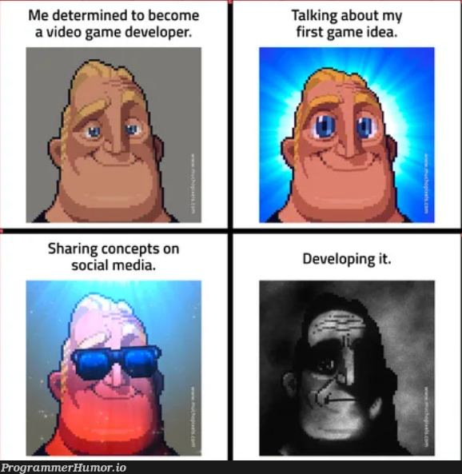
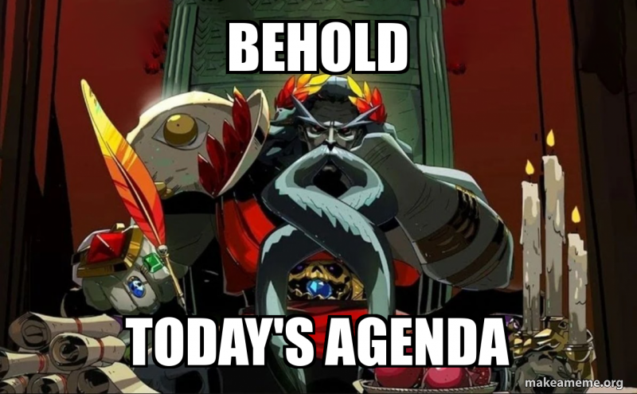
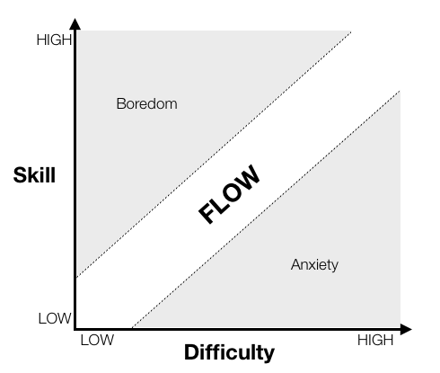

# Cours 9 – Jeux vidéo



*Image : mème de [ProgrammerHumor.io](https://programmerhumor.io/), reproduit à des fins pédagogiques (droits réservés à ses auteurs).*

## Ordre du jour



- [Retour sur la feuille de suivi](#retour-sur-la-feuille-de-suivi)
- [Activité — Jouer, puis analyser](#activite-jouer-puis-analyser)
- [Le domaine du jeu vidéo](#le-domaine-du-jeu-video)
- [Éléments importants en jeux vidéo](#elements-importants-en-jeux-video)
- [Exercice — Construction d'un exemple : un jeu vidéo](#exercice-construction-dun-exemple-un-jeu-video)
- [Pour aller plus loin](#pour-aller-plus-loin)
- [Préparation pour la semaine prochaine](#preparation-pour-la-semaine-prochaine)

## Retour sur la feuille de suivi 

- Correction des bogues (bouton retour, nom trop long, liker ne donne pas d'XP)
- Ajout de thème (licorne jour/nuit, Doom, thème personnalisé)

### Avez-vous un nouveau projet à ajouter? 

### Tournée ajout de *feature* ou bogues via les *issues*

## Activité — Jouer, puis analyser

Avant de nommer les concepts, on les observe. Gardez vos réponses : on y revient à la fin des [éléments importants](#retour-sur-lactivite).

1. **Seul(e), 5 minutes** : jouer à [Pac-Man](https://pacman.live/).
2. **En équipe de 2, 10 minutes** : répondre aux questions suivantes.
    - Quelle action répétez-vous sans arrêt? Qu'est-ce que le jeu vous renvoie après chaque action (son, image, points)?
    - Quelles sont les règles? Comment gagne-t-on, comment perd-on, qu'est-ce qui donne un bonus?
    - Le jeu change-t-il de façon de jouer à certains moments (menu, partie, fin de partie, niveau suivant)?
    - À quel moment avez-vous eu du plaisir? À quel moment avez-vous été frustrés ou tentés d'abandonner?
    - Y a-t-il une histoire? Qui est le personnage, que veut-il et qu'est-ce qui l'en empêche?
    - Comment décririez-vous le style visuel du jeu en trois mots (formes, couleurs, ambiance)?
3. **En groupe** : mise en commun.

## Le domaine du jeu vidéo

La **conception** (*game design*) se concentre sur la façon d'imaginer le jeu, alors que le **développement** (*game dev*) se concentre sur la façon de le faire. Les concepteurs imaginent l'expérience; les développeurs la transforment en réalité. La conception fait appel à un sens artistique, le développement à un sens logique, mais les deux restent étroitement liés. Pour revoir les étapes de production d'un jeu vidéo, consultez le [cours 7](./cours07.md#jeux-video).

### Les types d'entreprises

Pour revoir les types d'entreprises en général, consultez le [cours 6](./cours06.md#types-dentreprises).

| Type | Description | Exemples |
|---|---|---|
| **Grands studios** (jeux « AAA ») | Équipes de centaines de personnes, gros budgets, production de plusieurs années | Ubisoft Montréal, Eidos-Montréal, WB Games Montréal, Behaviour Interactive |
| **Studios indépendants** | Petites équipes, jeux plus modestes, grande liberté créative | Kitfox Games |
| **Jeux mobiles et occasionnels** | Jeux courts, souvent gratuits avec achats intégrés | Ludia |
| **Jeux sérieux et éducatifs** | Jeux conçus pour former, sensibiliser ou soigner (musées, entreprises, santé) | Selon le mandat |
| **Studios de service** | Sous-traitance d'une partie de la production (art, son, tests) | Selon le mandat |

Les exemples ne sont pas exhaustifs, et les studios changent vite (fermetures, rachats) : vérifiez leur situation actuelle avant de les citer dans votre travail.

### Les métiers

Dans les grands studios, chaque facette de la conception et de la production devient un métier.

| Métier | Ce qu'il fait |
|---|---|
| **Concepteur de jeu** (*game designer*) | Imagine l'expérience : mécaniques, boucle de jeu et phases de jeu |
| **Concepteur de niveaux** (*level designer*) | Conçoit l'espace de jeu et la disposition de l'environnement pour optimiser le *gameplay* |
| **Concepteur de système** (*system designer*) | Construit et équilibre les mécaniques (économie, combat, compétences, statistiques) |
| **Créateur de contenu** (*content creator*) | Écrit et conçoit les personnages, l'univers, l'intrigue, les dialogues et les missions |
| **Concepteur d'expérience** (*experience designer*) | S'occupe de la rétroaction et du ressenti du joueur (rôle plus rare, dans les très grandes équipes) |
| **Programmeur** | Programme les mécaniques, les outils et le moteur de jeu |
| **Artiste** | Dessine et modélise les personnages et les décors, anime, conçoit l'interface |
| **Concepteur sonore** | Crée les effets sonores, la musique et l'ambiance |
| **Assurance qualité** (*testeur*) | Teste le jeu, repère et documente les bogues |
| **Producteur** | Planifie, gère le budget, l'échéancier et l'équipe |

### Entrer dans le domaine

- Une formation : DEC en intégration multimédia, AEC ou études universitaires.
- Un **portfolio** de petits jeux et de prototypes, même simples.
- Des **game jams** (marathons de création de jeu de 24 à 72 heures) pour pratiquer en équipe.
- Un stage. L'assurance qualité est souvent une porte d'entrée vers d'autres postes.

## Éléments importants en jeux vidéo 

- **Le fun** — l'expérience devrait donner du plaisir
- **Le flow** — le défi est équilibré avec les capacités du joueur
- **Le style visuel** — des choix de forme, de couleur et d'éclairage cohérents qui créent l'ambiance
- **Les mécaniques** — des règles claires qui forment le jeu
- **La boucle et les phases de jeu** — une action qui donne envie de recommencer, rythmée par des phases
- **L'agentivité** — l'utilisateur doit avoir des choix significatifs
- **La narration** — l'histoire soutient le flow et met le *gameplay* en valeur

### Le fun

Selon Koster (2004), le *fun* est le **plaisir éprouvé lors de la résolution mentale d'un défi** : le cerveau trouve et découvre des motifs (*patterns*) dans le chaos. Ce plaisir est **subjectif** : on dira plutôt qu'un jeu *fun* est un jeu qui nous **divertit**, même si les émotions vécues peuvent être négatives (tristesse, conflit, haine, etc.).

Les sources de divertissement sont, entre autres :

- La curiosité
- L'évasion
- Le défi
- L'expression
- L'ingéniosité
- L'identification

Selon Ruswick (2017), un jeu doit donner envie de **commencer** et envie de **terminer**. Pour y arriver :

- Il doit être **simple à comprendre et difficile à maîtriser**.
- Le joueur doit construire un pont entre l'**objectif** (ce qu'on doit faire) et l'**obstruction** (ce qui nous empêche de le faire).
- Les défis et la progression doivent donner un sentiment de **satisfaction**.
- Le jeu doit créer de l'**émerveillement** en dépassant les attentes (suspense et surprise).

**Le fun se découvre plus souvent qu'il ne se construit** : cette découverte se fait grâce au prototype et aux tests.

#### Les types de joueurs

Un jeu s'adresse à un public cible. Pour mieux le cerner, on distingue différents types de joueurs (typologie inspirée de Bartle, 1996, adaptée par Nadeau, 2020) et on oriente le concept en conséquence :

| Type | Le plaisir provient de... |
|---|---|
| **Fonceur** (*achiever*) | L'accomplissement des objectifs du jeu (défi) |
| **Explorateur** (*explorer*) | L'exploration du jeu, le connaître de fond en comble (découverte) |
| **Social** (*socializer*) | Le développement de relations (camaraderie) |
| **Combattant** (*fighter*, *killer* chez Bartle) | S'imposer sur les autres : compétition, destruction ou aide et enseignement des autres |

#### Les catégories et les genres

Il est difficile de classer un jeu selon un seul aspect (*gameplay*, intrigue ou esthétique), car les jeux vidéo sont des processus interactifs. On les regroupe tout de même en grandes familles :

- Une **catégorie** est une grande famille de jeux (il y en a huit).
- Un **genre** est un sous-type plus précis à l'intérieur d'une catégorie (plateforme, tir, casse-tête, etc.).
- Plusieurs jeux mélangent les genres.

| Catégorie | Genres (exemples) | Jeu connu | Type de joueur attiré (tendance) |
|---|---|---|---|
| **Action** | Plateforme, tir, combat, arcade | Pac-Man, Super Mario | Fonceur |
| **Aventure** | Aventure-action, point-and-click | Zelda | Explorateur |
| **Jeu de rôle** | Au tour par tour, action-RPG | Pokémon | Explorateur, fonceur |
| **Simulation** | Gestion, vie, conduite | Les Sims | Explorateur |
| **Stratégie** | Tour par tour, temps réel | StarCraft, XCOM | Fonceur, combattant |
| **Sport** | Football, hockey, course | FIFA, Mario Kart | Combattant, social |
| **Réflexion** | Casse-tête, puzzle | Tetris | Fonceur |
| **Contemplatif** | Exploration sans pression | Journey | Explorateur |

La dernière colonne n'est qu'une tendance : un même type de joueur peut aimer plusieurs genres.

### Le flow

Le ***flow*** (Csikszentmihalyi, 1990) est l'état psychologique d'une personne totalement immergée dans l'accomplissement d'une tâche : très haut niveau de concentration et perception du temps faussée. Trois ingrédients pour l'atteindre :

- Des **objectifs clairs et précis**
- Une **valorisation constante des efforts** (la rétroaction de la boucle de jeu)
- Un **équilibre juste** entre les capacités du joueur et l'objectif ciblé (ni trop facile, ni trop difficile)



*Figure 1 : Flow, boredom, and anxiety as they relate to task difficulty and user skill level. Adapted from Csikszentmihalyi, 1990. Image : Sean Baron, « [Cognitive Flow: The Psychology of Great Game Design](https://www.gamedeveloper.com/design/cognitive-flow-the-psychology-of-great-game-design) », Game Developer, 2012. Droits réservés à l'auteur, image utilisée à des fins pédagogiques.*

Évitez d'interrompre le *flow* : par exemple, une longue cinématique au milieu de l'action le brise.

### Le style visuel

Le **style visuel** est l'ensemble des choix de forme, de couleur, de texture, d'éclairage et de niveau de détail qui donnent son aspect au jeu. C'est la partie de l'**esthétique** la plus proche du joueur : elle crée l'ambiance et permet l'immersion. Un jeu vidéo intègre d'ailleurs les grandes formes d'art : arts visuels, architecture et sculpture (modélisation, *level design*), musique, littérature, arts de la scène et cinéma.

Le style visuel se choisit en fonction de trois contraintes :

- **Les ressources de l'équipe** : le temps, le budget et les habiletés disponibles.
- **La technologie** : certaines mécaniques et certains rendus sont impossibles sans la technologie adéquate.
- **La lisibilité** : le joueur doit repérer rapidement ce qui est interactif et ce qui est important.

| Style | Caractéristiques | Exemple |
|---|---|---|
| **Pixel art** | Image composée de pixels visibles, palette réduite | Pac-Man, Space Invaders |
| **Dessiné à la main** | Illustration 2D, texture de dessin | Hollow Knight |
| **Silhouette minimaliste** | Noir et blanc, formes simples | Limbo |
| **Voxel** | Monde 3D construit en cubes | Minecraft |
| **3D stylisé** | Couleurs vives, formes simplifiées, ombrage « dessin animé » | Zelda : Breath of the Wild |
| **Réaliste** | Proportions, lumière et textures proches du réel | The Last of Us |

Une **direction artistique** cohérente se construit avec :

- Une **palette de 3 à 5 couleurs** liée à l'ambiance (chaude, froide, désaturée) et gardée tout au long du jeu
- Des **références visuelles** (jeux, films, peintures, photos) rassemblées dans un *moodboard*
- Le même style pour tous les éléments : personnages, décors et interface

### Les mécaniques

Les mécaniques sont les **règles**; le *gameplay* est l'**expérience** qui naît de leur combinaison. On en distingue trois niveaux :

- Les mécaniques **cœurs** (l'essence du jeu)
- Les mécaniques **secondaires** (la diversité du jeu)
- Les mécaniques **exotiques** (la diversité occasionnelle)

Le *game designer* veut éviter les idées géniales sur papier qui se transposent mal en partie réelle (bien en théorie, mais ennuyantes en pratique) : il faut éviter les tâches répétitives, peu surprenantes ou trop faciles.

*Exemple — Space Invaders*

- Mécaniques cœurs : le joueur déplace le canon à l'horizontale, il peut faire feu, son projectile détruit instantanément un alien, il a trois vies et perd s'il les perd toutes; les aliens se déplacent de gauche à droite, descendent d'une rangée après un cycle, tirent à une cadence régulière et leur projectile enlève une vie au joueur.
- Mécaniques secondaires : système de pointage, système de meilleur score (*high score*).

### La boucle et les phases de jeu

#### La boucle de jeu (*gameplay loop*)

La **boucle de jeu** (aussi appelée *core loop*) est le cycle d'actions que le joueur répète : **action → rétroaction → récompense → motivation à recommencer**. Elle est construite avec les mécaniques cœurs. Si elle n'est pas *fun* à répéter, aucune quantité de contenu ne sauvera le jeu.

On distingue généralement trois échelles de boucle :

| Boucle | Durée | Question à laquelle elle répond |
|---|---|---|
| **De moment en moment** (*moment-to-moment*) | Quelques secondes | Qu'est-ce que je fais maintenant? (sauter, tirer, esquiver) |
| **De session** (*session loop*) | Quelques minutes à une heure | Qu'est-ce que je cherche à accomplir pendant cette partie? (finir un niveau, gagner un match) |
| **De métajeu** (*meta loop*, *metagame*) | Plusieurs sessions | Pourquoi je reviens demain? (progression du personnage, collection, déblocages, classement) |

Attention à ne pas confondre avec la ***game loop*** des programmeurs : c'est la boucle du moteur de jeu qui, à chaque image, lit les commandes (*input*), met à jour l'état du jeu (*update*) et affiche le résultat (*render*).

#### Les phases de jeu (*gameplay phases*)

Une **phase de jeu** est un segment du jeu qui a ses propres règles, ses propres contrôles, sa propre interface et souvent sa propre ambiance visuelle et sonore. Passer d'une phase à l'autre change la façon de jouer, ce qui évite la monotonie et rythme l'expérience (alternance de tension et de repos).

Côté programmation, chaque phase correspond à un **état de jeu** (*game state*), et le jeu est géré par une **machine à états** (*state machine*) : à tout moment, le jeu se trouve dans un seul état, et des **transitions** déclenchées par une condition le font passer à un autre. Dans un schéma logique, chaque phase est un bloc et chaque transition est une flèche.

*Exemple — Pokémon (série principale)*

| Phase | Ce que fait le joueur | Contrôles et interface | Transition vers... |
|---|---|---|---|
| **Exploration** (*overworld*) | Se déplace dans le monde, parle aux personnages, cherche des objets, soigne son équipe au Centre Pokémon | Déplacement en temps réel, carte vue de dessus | **Combat** : rencontre dans l'herbe haute ou dresseur qui nous repère |
| **Combat** (*battle*) | Choisit une action à tour de rôle (attaquer, sac, changer de Pokémon, fuir) | Menu au tour par tour, écran différent | **Exploration** : victoire, fuite ou capture |
| **Menus** (*menu*) | Gère l'équipe, le sac, le Pokédex | Navigation dans des menus | **Exploration** : fermeture du menu |

- **Boucle de moment en moment** : choisir une attaque, voir l'effet, recevoir la rétroaction (animation, son, barre de vie).
- **Boucle de session** : explorer une route, combattre, soigner son équipe, atteindre la ville suivante et vaincre le champion d'arène.
- **Boucle de métajeu** : capturer, entraîner et faire évoluer ses Pokémon, obtenir des badges.
- **Transition mise en scène** : l'animation d'entrée en combat et le changement de musique signalent clairement au joueur qu'il change de phase.

*Exemple — Fortnite (bataille royale)*

1. **Lobby** : personnalisation du personnage, choix du mode, formation d'une équipe
2. **Appariement** (*matchmaking*) : attente de la partie
3. **Largage** : choix de l'endroit où atterrir
4. **Collecte** (*looting*) : ramasser armes et ressources
5. **Combat et rétrécissement de la zone** : la tension monte jusqu'au dernier joueur en vie
6. **Résultats** : classement, expérience et récompenses, puis retour au lobby

La phase de combat est la boucle de session; le lobby et les récompenses forment la boucle de métajeu qui donne envie de relancer une partie.

*Autre exemple — XCOM* : une phase de **gestion de la base** (recherche, construction, choix de la mission) alterne avec une phase de **combat tactique** au tour par tour. La première est le métajeu, la seconde le *core gameplay*.

**Quelques trucs pour concevoir ses phases**

- **Nommer** chaque phase et lister ses règles, ses contrôles et son interface.
- Définir la **condition de transition** entre les phases (victoire, défaite, temps écoulé, action du joueur).
- **Annoncer** les transitions avec une rétroaction claire (animation, musique, écran de chargement) pour ne pas désorienter le joueur.
- **Varier le rythme** : alterner phases d'action et phases de repos pour préserver le *flow*.

### L'agentivité

L'**agentivité** est le pouvoir d'influence du joueur sur le jeu. Jesper Juul (2002) distingue deux structures de jeu :

| | Jeu progressif | Jeu émergent |
|---|---|---|
| **Définition** | « Un jeu dans lequel le joueur fait face à des défis en série et où les options ainsi que les solutions sont définies par le développeur. » | « Un jeu déterminé par un ensemble de règles qui se combinent pour offrir de nombreuses variations, où le *gameplay* émerge de l'agentivité du joueur. » |
| **Structure** | Linéaire, solutions prédéterminées | Non linéaire, le joueur invente ses stratégies |
| **Fin** | Conclusions clairement définies, moins de rejouabilité | Fins ouvertes (*open ending*), beaucoup de rejouabilité |
| **Exemples** | Halo, Uncharted, The Last of Us, Super Mario, Hollow Knight | Échecs, StarCraft, Zelda, GTA, Minecraft |

Il est difficile de classer un jeu de façon absolue : la narration peut être très progressive alors que le *gameplay* est émergent, et inversement. On place plutôt un jeu sur un **spectre**.

### La narration

Un jeu raconte aussi une histoire, même simple : Pac-Man a un personnage, un objectif et des obstacles. En jeu vidéo, la narration est là pour **soutenir le *flow*** (elle donne un but au joueur et une raison de continuer) et **mettre le *gameplay* en valeur**, pas pour le remplacer : on ne l'écrit pas comme un scénario de film. Pour revoir l'intrigue, les personnages et l'univers, consultez le [cours 7](./cours07.md#elements-importants-en-audiovisuel).

### Retour sur l'activité

Reprenez vos réponses sur Pac-Man et nommez ce que vous aviez observé :

- L'action répétée et ce qu'elle rapporte : la **boucle de jeu**
- Les règles et les conditions de victoire et de défaite : les **mécaniques cœurs et secondaires**
- Les changements de façon de jouer : les **phases de jeu** et leurs **transitions**
- Les moments de plaisir et de frustration : la **source du fun** et l'équilibre du **flow**
- Le type de joueur à qui le jeu s'adresse : les **types de joueurs**
- La famille à laquelle il appartient : sa **catégorie** et son **genre**
- Les trois mots du style visuel : le **style visuel** (et la palette de couleurs)
- Les choix du joueur : plutôt **progressif** ou **émergent**?
- Le personnage, ce qu'il veut et ce qui l'en empêche : la **narration**

## Exercice — Construction d'un exemple : un jeu vidéo

Contraintes :

- Jeu 2D, solo
- Jeunes adultes de 18 à 25 ans à la recherche de sensations
- Une partie dure de 5 à 10 minutes et la rejouabilité doit rester intéressante (expliquez pourquoi)
- Une seule mécanique cœur et une seule mécanique secondaire
- Au moins deux phases de jeu 
- Jouable au clavier ou à la souris

En équipe de 2-3, construisez le projet en suivant les étapes ci-dessous. Notez vos réponses au fur et à mesure : elles serviront à rédiger la page GitHub Pages de l'étape 5. Chaque membre publie ensuite la page sur son propre compte GitHub.

#### Étape 1 — Idéation : le public cible

- **Type de joueur visé** : fonceur ou explorateur (le jeu est solo).
- **Catégorie et genre** : choisissez dans le [tableau des catégories et des genres](#les-categories-et-les-genres).
- **Le concept en une phrase** (*logline*, voir le [cours 7](cours07.md#le-concept-et-laudience)) : un personnage, un objectif, un obstacle. Transformez radicalement un jeu existant que vous connaissez (exemple : un jeu de gestion de parc d'attractions devient un jeu de combat où il faut le détruire).

#### Étape 2 — Préproduction : les mécaniques et le fun

Définissez :

- Le **nom** du jeu (unique et pertinent)
- L'**objectif** du jeu et les conditions de victoire et de défaite
- La **mécanique cœur** et la **mécanique secondaire**
- La **boucle de jeu** : action → rétroaction → récompense
- Les **phases de jeu** (exemple : exploration → combat → résultats) et la condition de transition entre elles
- La **source du fun** pour le type de joueur visé : expliquer la source de plaisir sans dire fun (utiliser les [sources de divertissement](#le-fun))
- Le ***flow*** : comment le jeu équilibre-t-il le défi et les capacités du joueur?
- Le **type de structure** : progressif ou émergent? (expliquez en quelques mots)
- La **rétroaction** : que se passe-t-il (son, lumière, animation) quand le joueur réussit ou échoue?

#### Étape 3 — Histoire, esthétique et interface

- **Histoire** (pour revoir ces notions, consultez le [cours 7](cours07.md#elements-importants-en-audiovisuel)) :
    - le **personnage principal** : sa description, son désir (ce qu'il veut), son besoin (ce qu'il lui faut) et ses habiletés spéciales qui influencent le *gameplay*;
    - l'**intrigue en 4 temps** : le début, le milieu, le revirement et la fin, en une phrase chacun. Associez chaque temps à une **phase de jeu** ou à une **transition**;
    - l'**univers** : où et quand se passe le jeu, et un élément de folklore mis en scène par le style visuel plutôt qu'expliqué;
    - le **lien avec le *gameplay*** : comment la mécanique cœur exprime le désir du personnage?
- **Esthétique** :
    - un [style visuel](#le-style-visuel) choisi dans le tableau, justifié par les ressources de l'équipe et la lisibilité du jeu;
    - une palette de 3 à 5 couleurs (codes hexadécimaux, ex. `#1E90FF`);
    - 3 liens vers des images de référence qui illustrent votre style;
    - l'ambiance sonore.
- **Interface** : la liste des objets jouables et un croquis de l'écran principal (HUD, menu).

#### Étape 4 — Trouver des ressources libres de droits

Trouvez **une image** (personnage, décor ou élément d'interface) et **un son ou une musique** d'ambiance. Pour chacun :

1. Identifiez sa licence.
2. Rédigez la mention d'attribution (voir l'[étape 4 du cours 8](cours08.md#etape-4-trouver-des-ressources-libres-de-droits)).

Sites pour les ressources de jeu :

- **Images, sprites et interfaces** : [OpenGameArt](https://opengameart.org/), [itch.io (ressources gratuites)](https://itch.io/game-assets/free), [Game Art 2D](https://www.gameart2d.com/freebies.html), [CraftPix](https://craftpix.net/freebies/)
- **Sons** : [Freesound](https://freesound.org/)
- **Musique** : [Bensound](https://www.bensound.com/), [Incompetech](https://incompetech.com/music/royalty-free/), [Free Music Archive](https://freemusicarchive.org/search)

Ces sites regroupent des ressources aux licences variées (CC0, CC BY, etc.) : vérifiez la licence **de chaque fichier**.

#### Étape 5 — Créer le dépôt et rédiger la page

1. Créer un nouveau dépôt **public** nommé `concept-jeu`, avec un fichier `README.md`.
2. Téléverser le croquis de l'interface et l'image dans le dépôt, sous les noms exacts `interface.jpg` et `ressource.jpg` : **Add file** → **Upload files**.
3. Copier le modèle ci-dessous dans le `README.md`, puis remplacer chaque `...`.

```markdown
# Titre du jeu

Projet conçu en équipe avec : [prénoms des coéquipiers]

## Le public cible

- Type de joueur visé (fonceur ou explorateur) : ...
- Catégorie et genre : ...
- Le concept en une phrase (un personnage, un objectif, un obstacle) : ...

## Les mécaniques

- Objectif du jeu : ...
- Condition de victoire : ...
- Condition de défaite : ...
- Mécanique cœur : ...
- Mécanique secondaire : ...
- Structure (progressif ou émergent, expliquez en quelques mots) : ...
- Prototype Scratch (facultatif) : [lien du projet](lien)

## Les phases de jeu

- La boucle de jeu (action → rétroaction → récompense) : ...
- Phase 1 : ... (règles, contrôles, interface)
    - Transition vers la phase 2 : ...
- Phase 2 : ... (règles, contrôles, interface)
    - Transition vers la phase suivante ou la fin : ...

## Le fun et le flow

- La source du fun pour le type de joueur visé (sans utiliser le mot *fun*) : ...
- Le flow (équilibre défi / capacités) : ...
- La rétroaction (son, lumière, animation) : ...
- La rejouabilité (pourquoi recommencer) : ...

## L'histoire

- Le personnage principal (description, désir, besoin, habiletés spéciales) : ...
- Le début (phase de jeu ou transition associée) : ...
- Le milieu (phase de jeu ou transition associée) : ...
- Le revirement (phase de jeu ou transition associée) : ...
- La fin (phase de jeu ou transition associée) : ...
- L'univers (où, quand, un élément de folklore) : ...
- Comment la mécanique cœur exprime le désir du personnage : ...

## L'esthétique et l'interface

- Le style visuel (et pourquoi il convient à votre jeu) : ...
- La palette de couleurs : ...
- Trois images de référence : [image 1](lien), [image 2](lien), [image 3](lien)
- L'ambiance sonore : ...
- Les objets jouables : ...
- Croquis de l'interface :


## Les ressources


- Son d'ambiance : [titre du son](lien)
- Crédits :
    - « Titre de l'image », par ..., [Source](lien), [Licence](lien)
    - « Titre du son », par ..., [Source](lien), [Licence](lien)
```

Pour ajouter les images à la page, voir la [procédure du cours 8](cours08.md#procedure-ajouter-une-image-a-une-page-github-pages).

#### Étape 6 — Publier sur GitHub Pages

1. Aller dans **Settings** → **Pages**.
2. Sous *Branch*, choisir **main** puis **/ (root)**, et cliquer sur **Save**.
3. Rafraîchir la page après une minute : GitHub affiche l'adresse du site publié.

Voir aussi [Publier sur GitHub Pages](cours04.md#publier-sur-github-pages) au cours 4.

#### Facultatif — Prototyper la boucle dans Scratch

Reproduisez la mécanique cœur et sa rétroaction dans un projet Scratch, puis ajoutez le lien du projet dans la section « Les mécaniques » de votre page. Faites-le tester par une autre équipe en notant ses observations sur le *flow* et le *fun*.

**Remise sur Teams** : le lien de votre page GitHub Pages.

## Pour aller plus loin

Notions complémentaires, utiles pour affiner votre concept ou votre prochain projet.

- **La tétrade** : quatre éléments travaillent conjointement pour créer une expérience immersive, et chaque choix dans un élément dépend des trois autres. L'**esthétique** est l'ambiance visuelle et sonore, les **mécaniques** sont les règles et l'objectif, l'**histoire** est la séquence d'événements (linéaire ou émergente) et la **technologie** est ce qui permet au joueur d'interagir (cela pourrait être du papier et un crayon).
- **L'interface (UI et UX)** : l'*interface utilisateur* comprend le HUD (*heads-up display* : vie, énergie, munitions) ainsi que les menus et la gestion (inventaire). L'*expérience utilisateur* en conçoit l'architecture : une maquette illustre le *flow* de l'interface, puis le concepteur UI la concrétise. Le *motion graphics* anime la rétroaction : une bonne animation est **responsive**, **dirigée**, **cohérente** et **intuitive**.
- **Le *storytelling*** : trois piliers sont mobilisés (Extra Credits, 2018) : l'**intrigue**, les **personnages** et le **folklore** (*lore*). En jeu vidéo, la narration est toujours au service du *gameplay* : on la justifie par l'esthétique et la mécanique.
- **La conception de niveaux** : un bon niveau est *fun* à explorer, montre l'intrigue plutôt que de la raconter, montre **quoi** faire sans dire **comment** (objectif clair, moyen flou), apprend de nouvelles choses au joueur, fait progresser la tension dramatique et surprend. Le croquis à vol d'oiseau est un guide qui évolue avec les tests.

## Préparation pour la semaine prochaine

La semaine prochaine : constitution du dossier de mandats. Choisissez dès maintenant vos 3 meilleurs mandats parmi les 5 réalisés.

## Merci et à la semaine prochaine!

Commentaires ou questions?
