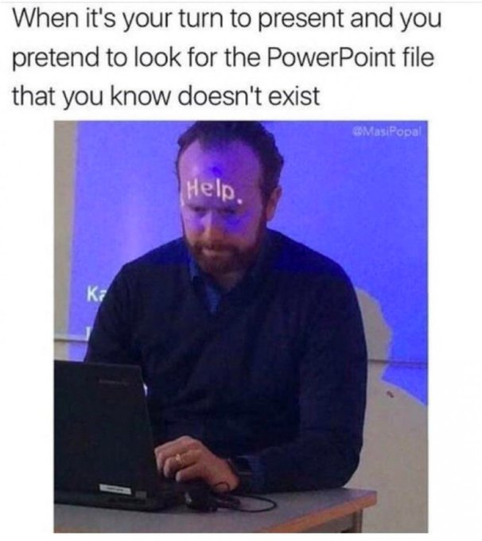
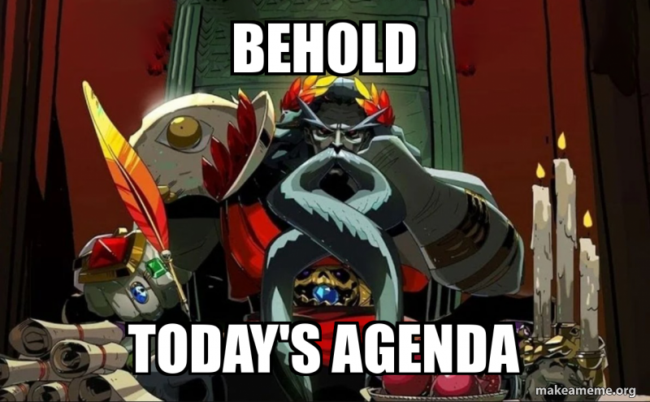
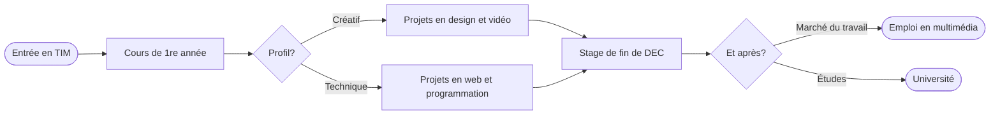

# Cours 10 – Outils de présentation et d'organisation

*Image : mème de @MasiPopal, reproduit à des fins pédagogiques (droits réservés à ses auteurs).*

## Ordre du jour

- [Retour sur la feuille de suivi](#retour-sur-la-feuille-de-suivi)
- [Préparation pour la conférence](#préparation-pour-la-conférence)
- [Qu'est-ce qu'une bonne présentation?](#quest-ce-quune-bonne-présentation)
- [Choisir le bon outil](#choisir-le-bon-outil)
- [La carte mentale](#la-carte-mentale)
- [Le diagramme de flux](#le-diagramme-de-flux)
- [PowerPoint, Canva ou GitHub : lequel choisir?](#powerpoint-canva-ou-github-lequel-choisir)
- [Exercice — Même présentation, deux outils](#exercice-même-présentation-deux-outils)
- [GitHub et GitHub Pages comme outil de présentation](#github-et-github-pages-comme-outil-de-présentation)
- [Présentation du TP2](#présentation-du-tp2)
- [Préparation pour la semaine prochaine](#préparation-pour-la-semaine-prochaine)

## Retour sur la feuille de suivi 

- Correction des bogues (projets dupliqués, onglet projet qui se ferme)
- Ajout de thèmes (5x noël)

## Préparation pour la conférence

N'oubliez pas que nous avons une conférence sur le *game design* mardi  le 17 novembre prochain à 18h30 au grand studio. Pour mettre en contexte, nous allons rencontrer Morgan Alexandra Cork qui travaille présentement chez Panache Studio. Un studio montréalais qui développe présentement le jeu [Amsterdam 1666](https://www.youtube.com/watch?v=6nUzNiiCi2Q)

## Qu'est-ce qu'une bonne présentation?

Une présentation numérique est un **support** à votre parole, pas un document à lire. Le public doit pouvoir vous écouter et regarder l'écran en même temps.

### La simplicité

Une bonne présentation permet d'abord et avant tout de capter ainsi que de retenir l'attention. Pour y arriver, quelques trucs peuvent être mobilisés : 

- **Éviter les blocs de texte** : des mots-clés, pas des phrases complètes.
- **1 diapositive = 1 idée** : si une diapositive contient deux idées, faites-en deux.
- **Le temps** : la règle générale est d'environ 1 minute par diapositive : une image forte et quelques mots-clés.

### Le style 

Le style visuel de votre présentation peut faire la différence au niveau de l'impression. Un mauvais contenu ne peut pas être sauvé par l'apparence, néanmoins elle peut faire un impact positif si l'esthétique est bien choisie en fonction du thème.  

L'idéal est de définir une direction artistique et pour se guider, il est idéal de faire un moodboard avec les éléments suivants : 

- **Couleurs** : une palette de 3 à 5 couleurs, utilisée partout.
- **Polices** : **1 ou 2 polices** au maximum, une taille d'au moins **30 points** pour le texte courant, et un bon **contraste** avec le fond (texte pâle sur fond foncé, ou l'inverse).
- **Alignement** : les éléments s'alignent sur une grille invisible, toujours au même endroit d'une diapositive à l'autre (titre, image, texte).

### Remplacer le texte

Un graphique, un schéma ou une image explique souvent mieux que les mots. Avant d'écrire une liste à puces, demandez-vous si un visuel ferait mieux le travail.

### Les images

- **Taille** : une image en bonne résolution, jamais étirée ni pixellisée.
- **Nombre** : une image forte vaut mieux que cinq petites.
- **Droits d'auteur** : chaque image est libre de droits ou citée (voir [Droits d'auteur et éthique](cours08.md#droits-dauteur-et-ethique) au cours 8).

### Citer ses sources

On cite ses sources par **respect** pour les auteurs, pour suivre la **politique** du collège (voir le plan de cours) et pour sa **crédibilité**. Les crédits vont en **bas de diapositive** ou sur une **diapositive de fin**, au format vu au [cours 8](cours08.md#etape-4-trouver-des-ressources-libres-de-droits) : `« Titre de l'œuvre », par Auteur, Source, Licence`.

### Les transitions et les animations

Avec **parcimonie** et **stratégie** : une seule transition simple, la même pour toute la présentation. Une animation doit servir le propos (faire apparaître une idée au bon moment) et rendre l'expérience de lecture fluide, mais pas décorer.

### Les fautes d'orthographe

Une faute à l'écran se voit en très grand. Passez votre présentation dans **Antidote** avant la remise. N'oubliez pas que la qualité de la langue compte jusqu'à 10 % de la note.

### La pratique à l'oral

- Ne pas lire ses diapositives : elles contiennent les mots-clés, vous dites le reste.
- Répéter à voix haute, **chronomètre en main**.
- Vérifier avant son tour que le fichier s'ouvre sur l'ordinateur de la classe (et avoir une copie en PDF au cas où).

## Choisir le bon outil

Il existe de nombreuses façons de communiquer une idée. Selon le contexte, un texte seul ne suffit pas. En effet, les  images, graphiques ou schémas représentent mieux certaines idées.

| Outil | Ce que c'est | Idéal pour | Limites |
|---|---|---|---|
| **Présentation classique** | Diapositives avec texte, images et graphiques | Résumer un projet du début à la fin, devant un public | Linéaire, peu interactive |
| **Storyboard** (scénarimage) | Série d'images en séquence qui montre les étapes d'une histoire | Présenter la progression d'un projet visuel (film, animation) | Demande du temps et du dessin |
| **Moodboard** | Collage d'inspiration : couleurs, typographies, images, mots-clés | Présenter une direction artistique | Peu structuré pour la logique ou les données |
| **Carte mentale** | Idées reliées autour d'un concept central | Faire un remue-méninges, classer de l'information | Illisible avec trop d'idées |
| **Diagramme de flux** | Étapes d'un processus avec boîtes, flèches et symboles | Expliquer une logique, un parcours ou un projet interactif | Complexe avec trop de branches |
| **GitHub et GitHub Pages** | Documentation en Markdown publiée comme site web | Documenter un projet, le partager par un lien, le garder à jour | Pas de mode diaporama, mise en page limitée |

Ces outils se combinent : dans le TP2, la présentation classique **contient** les autres (moodboard, carte mentale, diagramme de flux), et GitHub **documente** le tout.

## La carte mentale

La **carte mentale** (aussi appelée carte heuristique ou *mind map*) est :

- une carte qui représente plusieurs idées;
- une **idée centrale** entourée de **sous-thématiques**;
- une manière imagée de représenter de l'information;
- une façon de **classer** de l'information.

### Les composantes

- **Un sujet principal**, au centre
- **Des sous-thématiques**, en branches qui partent du centre et se subdivisent
- **Des images ou des pictogrammes**, pour retenir les idées d'un coup d'œil
- **De la couleur**, une par branche principale, pour regrouper les idées

Exemples commentés : [Les cartes heuristiques pour résumer](https://www.ebsi.umontreal.ca/jetrouve/projet/cartes_m/resumer.htm) (EBSI, Université de Montréal).

### Les outils

| Outil | Pourquoi |
|---|---|
| **Papier et crayon** | Le plus rapide, et la meilleure méthode pour retenir. Photographiez le résultat. |
| **[diagrams.net](https://app.diagrams.net/)** | Gratuit, en ligne, simple, permet d'ajouter des images. Export en JPEG ou PNG. |
| **Canva** ou **Figma** | Gabarits de cartes mentales, facile à harmoniser avec votre moodboard. |
| **Illustrator** ou **Photoshop** | Contrôle complet des couleurs et des images, export rapide. |
| **Mermaid** | Une carte mentale écrite en texte, directement dans un fichier Markdown sur GitHub (voir [plus bas](#les-diagrammes-mermaid)). |

## Le diagramme de flux

Le **diagramme de flux** (ou organigramme, *flowchart*) illustre les étapes d'un processus et les choix qui le font bifurquer. On l'a déjà utilisé pour les phases de jeu au [cours 9](cours09.md#les-phases-de-jeu-gameplay-phases).

Les symboles de base :

| Symbole | Sens |
|---|---|
| **Ovale** | Début ou fin |
| **Rectangle** | Une étape |
| **Losange** | Une décision (oui ou non, choix A ou B) |
| **Flèche** | Le sens du parcours |

Exemple : un parcours possible après le DEC.

Pour le TP2, votre diagramme présente **votre** parcours : formation, stages, projets et carrières possibles.

### Les logiciels de présentation

| Logiciel | Forces | À savoir |
|---|---|---|
| **PowerPoint** | Standard partout, installé au collège, beaucoup de contrôle | Compte Microsoft du collège (Office 365) |
| **Google Slides** | Gratuit, en ligne, collaboration en temps réel | Moins d'options de mise en page |
| **Canva** | Gabarits soignés, banque d'images, export en PDF ou PPTX | Vérifier la licence des éléments payants (couronne) |
| **Figma** | Contrôle précis de la mise en page, mode présentation | Pensé pour le design d'interface, plus long à prendre en main |

Peu importe le logiciel : exportez une copie en **PDF** avant de présenter. Un PDF s'ouvre partout et ne change pas de police.

## PowerPoint, Canva ou GitHub : lequel choisir?

Au département, trois outils reviennent souvent. Ils ne servent pas exactement à la même chose : les deux premiers sont faits pour **présenter en direct**, le troisième pour **publier et documenter**.

### Comparaison

| | **PowerPoint** | **Canva** | **GitHub / GitHub Pages** |
|---|---|---|---|
| **Type** | Logiciel de présentation (installé ou en ligne) | Outil de design en ligne | Documentation Markdown publiée comme site web |
| **Forces** | Standard partout, fonctionne **sans Internet**; contrôle précis (masque, animations, mode présentateur); installé au collège | **Gabarits soignés** et rapides à adapter; banque d'images, d'icônes et de polices; collaboration en temps réel; résultat professionnel sans effort | **Un seul lien** à partager; toujours à jour; historique des versions; accessible sur téléphone; gratuit; idéal pour un portfolio |
| **Faiblesses** | Aspect « gabarit par défaut » si on ne le personnalise pas; fichier lourd avec beaucoup d'images; polices absentes sur un autre ordinateur | Demande **Internet**; éléments payants (couronne) et **licences** à vérifier; on se ressemble tous avec les mêmes gabarits; moins de contrôle fin | **Pas de mode diaporama**; mise en page limitée par le thème; contenu **public**; courbe d'apprentissage (Markdown, dépôt) |
| **Idéal pour** | L'exposé en classe | Une présentation très visuelle, vite faite | La documentation du TP2 et le portfolio |
| **Coût** | Compris avec le compte Office 365 du collège | Gratuit (version de base) | Gratuit |

### PowerPoint : survol

1. Ouvrir PowerPoint avec votre compte du collège (Office 365) et choisir une **présentation vide** ou un thème sobre.
2. Régler d'abord le **masque des diapositives** (**Affichage** → **Masque des diapositives**) : y définir une seule fois les polices, les couleurs et la position du titre. Toutes les diapositives suivent votre charte graphique.
3. Ajouter une diapositive par idée (**Accueil** → **Nouvelle diapositive**), puis insérer les images (**Insérer** → **Images**) et les formes ou schémas (**Insérer** → **Formes**, **SmartArt**).
4. Choisir **une** transition (**Transitions**) et l'appliquer à toutes les diapositives.
5. Écrire ses repères dans les **notes** sous la diapositive, puis répéter avec le **mode Présentateur** (**Diaporama** → **Mode Présentateur**, ou touche **F5** pour démarrer).
6. Exporter en **PDF** : **Fichier** → **Exporter** → **Créer un document PDF**.

### Canva : survol

1. Aller sur [canva.com](https://www.canva.com/) et ouvrir une session (un compte gratuit suffit).
2. **Créer un design** → **Présentation (16:9)**, puis choisir un **gabarit** qui ressemble à votre moodboard.
3. Adapter le gabarit à **votre** charte : onglet **Éléments** (formes, icônes, images), **Texte** (polices) et **Téléverser** (vos propres images). Changer les couleurs et les polices pour toutes les diapositives d'un coup.
4. Attention aux éléments marqués d'une **couronne** : ils sont payants. Gardez ceux qui sont gratuits et notez la source des images (voir [Citer ses sources](#citer-ses-sources)).
5. Cliquer sur **Présenter** pour répéter en plein écran.
6. Exporter : **Partager** → **Télécharger** → **PDF** (pour présenter) ou **PPTX** (pour modifier dans PowerPoint).

### GitHub : survol

Les étapes détaillées sont dans la section [GitHub et GitHub Pages](#github-et-github-pages-comme-outil-de-presentation) et dans l'[atelier](#atelier-demarrer-le-tp2). En résumé :

1. Créer un dépôt **public** avec un fichier `README.md`.
2. Écrire le contenu en Markdown : un titre `##` par « diapositive ».
3. Téléverser les images (**Add file** → **Upload files**) et les insérer avec ``.
4. Publier : **Settings** → **Pages** → *Branch* **main**, **/ (root)** → **Save**.
5. Partager le lien `https://votre-nom-utilisateur.github.io/nom-du-depot/`.

### Lequel choisir?

| Si vous voulez... | Choisissez |
|---|---|
| Présenter devant la classe, même sans Internet | **PowerPoint** |
| Un résultat très visuel rapidement, à partir d'un gabarit | **Canva** |
| Garder une trace en ligne, partageable par un lien | **GitHub Pages** |
| Un fichier fiable le jour de l'exposé | **PowerPoint ou Canva**, avec une copie **PDF** |

Pour le TP2, la combinaison gagnante : **PowerPoint ou Canva** pour l'exposé oral, **GitHub** pour la documentation.

## Exercice — Même présentation, deux outils

Vous allez réaliser la **même mini-présentation de 3 diapositives** dans PowerPoint, puis dans Canva, et comparer. Le contenu vient du [TP2](evaluation-expose.md) : il vous servira pour votre vraie présentation.

Les 3 diapositives :

1. **Page de titre** : nom, prénom, titre, cours et session.
2. **Mon profil** : 3 mots-clés et 1 image.
3. **Mon meilleur projet** : 1 capture et 1 phrase.

Individuel. Si possible, reprenez les **couleurs et les polices de votre feuille de personnage**.

### Exercice 1 — PowerPoint : le masque (15 min)

Les menus sont détaillés dans [PowerPoint : survol](#powerpoint-survol).

1. Ouvrir PowerPoint avec votre compte du collège et choisir une présentation vide.
2. Dans le **masque des diapositives**, choisir **2 polices**, **3 couleurs** et la position du titre, puis fermer le masque.
3. Créer les 3 diapositives. Mots-clés seulement, texte d'au moins **30 points**.
4. Appliquer **une seule transition** à toutes les diapositives.
5. Écrire une courte note de présentateur sous chaque diapositive, puis lancer le diaporama avec **F5**.
6. Exporter en **PDF**.

Auto-vérification : une idée par diapositive · les polices et couleurs viennent du masque (aucun réglage manuel) · la source de l'image est citée en bas · le PDF s'ouvre.

### Exercice 2 — Canva : adapter un gabarit (15 min)

Les étapes sont détaillées dans [Canva : survol](#canva-survol).

1. **Créer un design** → **Présentation (16:9)**.
2. Choisir un gabarit **sans couronne** dont l'ambiance se rapproche de votre palette.
3. Refaire les **mêmes 3 diapositives** : remplacer le texte par vos mots-clés, changer les **couleurs et les polices** pour toute la présentation d'un coup, téléverser vos images.
4. Remplacer ou supprimer tout élément marqué d'une **couronne**.
5. Ajouter la source de l'image en bas de la diapositive, puis cliquer sur **Présenter** pour tester.
6. Exporter en **PDF**.

## GitHub et GitHub Pages comme outil de présentation

On a utilisé GitHub et GitHub Pages pour publier les exercices des cours 8 et 9 (revoir [GitHub](cours04.md#github) et [GitHub Pages](cours04.md#github-pages) au cours 4). Ce n'est pas qu'un outil de programmeur : c'est aussi un **outil de présentation**, surtout pour la documentation et le portfolio.

D'ailleurs, les notes de cours que vous lisez en ce moment sont écrites en Markdown et publiées comme site web.

### Comment GitHub présente votre projet

- **Le `README.md` est la page couverture du dépôt** : GitHub l'affiche automatiquement sous la liste des fichiers. C'est la première chose qu'un employeur ou un client voit.
- **GitHub Pages publie le même Markdown comme site web**, à une adresse que vous pouvez partager : `https://votre-nom-utilisateur.github.io/nom-du-depot/`.
- **Une section `##` joue le rôle d'une diapositive** : un titre, une idée, une image.

### Forces et limites

| Forces | Limites |
|---|---|
| **Un seul lien** à partager, qui s'ouvre sur un ordinateur comme sur un téléphone | **Pas de mode diaporama** : la page se lit en défilant |
| **Toujours à jour** : on corrige le fichier, le site suit | **Mise en page limitée** par le thème |
| **Historique des versions** : chaque *commit* est conservé | Les diagrammes Mermaid ne s'affichent pas sur le site GitHub Pages (voir plus bas) |
| Texte, images, liens, vidéos (par lien) et code au même endroit | **Public** : attention aux droits d'auteur et aux renseignements personnels |
| **Gratuit** | |

### Présentation classique ou GitHub Pages?

| Situation | Outil |
|---|---|
| Présenter devant un public, en direct | Présentation classique |
| Laisser une trace consultable après la présentation | GitHub Pages |
| Montrer un projet à un employeur (portfolio) | GitHub Pages, avec le PDF de la présentation dans le dépôt |
| Documenter un projet qui évolue ou qui contient du code | GitHub (le `README.md`) |

### Présenter des diapositives avec GitHub Pages? 

Il est également possible d'ajouter des scripts à notre publication GitHub Pages pour la rendre dynamique. Par exemple, compendium est basé sur [MkDocs](https://www.mkdocs.org/) un module qui génère un site statique avec un thème et un mode présentation. Si cela, vous intéresse, je pourrais potentiellement vous partager un modèle.   

## Présentation du TP2

[Devis](./evaluation-expose.md)

### Atelier

Utilisez la période pour avancer chacune des pièces du travail. L'enseignant passe voir chaque étudiant.

## Préparation pour la semaine prochaine

Le cours prochain est entièrement consacré à l'**exposé du TP2**, en petits groupes. Avant le cours :

- Terminer la présentation, le moodboard, la carte mentale, le diagramme de flux et le dépôt GitHub.
- Répéter votre exposé à voix haute.
- Remettre le dossier sur Teams selon la nomenclature `nom-prenom_expose_02_582-101MO`.

Votre présence est obligatoire pendant la période de votre groupe: une absence à la présentation entraîne la note 0.

## Merci et à la semaine prochaine!

Commentaires ou questions?
