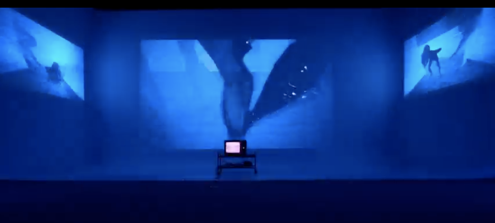

# Projet 2 : Installation Immersive et Vidéo Mosaïque - Partie 3 : le montage online 

> Le devis du TP est sujet à changement d'ici sa distribution officielle

## Consignes
Créer une expérience immersive en utilisant des éléments visuels et sonores pour raconter une histoire. Le travail est en équipe (4 personnes). 
Pour réaliser ce projet, nous vous suggerons les thèmes suivant :  

- Anomalie

- Passage

- Rupture

- Amalgamme 

Exemples:  
[Projets artistes ](https://cmontmorency365-my.sharepoint.com/:w:/g/personal/flpilote_cmontmorency_qc_ca/EdWLzr5Q0PdOnqxowv9_kBYBJzHbx4gT3zch9B2hIO3jzw?e=84Ld9o)

---

### Contraintes Techniques

#### **Installation Immersive**
Cette version combine trois écrans sur un cyclorama, une télévision au sol, des haut-parleurs et des lumières interactives pour une expérience narrative multisensorielle.

- **Éléments requis :**

  - **Trois écrans sur le cyclorama :**  
    Tournez des séquences originales pour les projeter de manière synchronisée sur les écrans. Intégrez des perspectives variées pour enrichir la narration.

  - **Télévision au sol :**  
    Présentez des vidéos complémentaires aux projections des écrans (gros plans, détails narratifs, angles alternatifs).

  - **Lumières interactives :**  
    Programmez des lumières pour réagir à la bande sonore et aux vidéos, amplifiant les moments clés de votre récit.

  - **Synchronisation audio-vidéo :**  
    Créez une bande sonore originale, et synchronisez-la avec vos séquences vidéo.

- **Critères de réussite pour la version Installation :**
  1. **Cohérence visuelle et sonore :** Tous les éléments (écrans, télévision, lumières, son) doivent fonctionner ensemble pour raconter une histoire immersive.

  2. **Synchronisation précise :** Les vidéos et le son doivent être parfaitement synchronisés pour maximiser l'impact narratif.

  3. **Interaction des lumières :** Les lumières doivent renforcer l’immersion en réagissant de manière cohérente avec les vidéos et le son.

### Consignes additionnelles 

- La vidéo doit durer environ cinq (5) minutes

## La partie 3 comprend :

### Le montage online (en équipe) :

- choisir un montage offline parmis ceux que vous avez réalisé à l'étape précédente ou mettre en commun les meilleurs parties de vos montages.

- Des transitions appropriées

- Un traitement de colorisation

- L'intégration d'au moins 4 effets de traitement d'image

- Un générique de fin selon les normes présentées en classe

- Traitement avancé de la bande sonore 

### Le dossier de remise (un par équipe) doit comprendre les éléments suivants :

- Le fichier de préparation avec tous les médias et les drp

- Le rendu final au format .mp4 codec H.264 à 30fps

## Critères d'évaluation

Les aspects évalués sont les suivants :

| Catégorie | Sous-critère | Points |
|---|---|---|
| **Montage et post-production** | | **/80** |
| | Rythme | /10 |
| | Trame sonore | /5 |
| | Qualité des transitions | /25 |
| | Qualité de la coloration | /25 |
| | Qualité du traitement des texte (typo et animation) | /10 |
| | Présence de tous les éléments au générique | /5 |
| **Présentation en classe** | | **/10** |
| | Bon déroulement du visionnement | /5 |
| | Pertinence des réponses aux questions | /5 |
| **Dossier de remise** | | **/10** |
| | Respect des formats | /5 |
| | Présence de tous les éléments | /5 |
| **Total** | | **/100** |

> Un manquement au respect du format et à la présence de tous les éléments sera pénalisé sur la préparation du tournage.

> N'oubliez pas que la qualité de la langue est évaluée jusqu'à concurrence de 10% de la note finale du travail (1% par faute).

