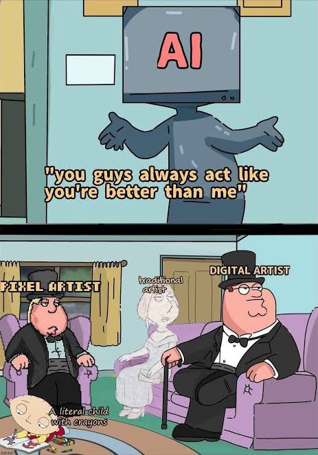
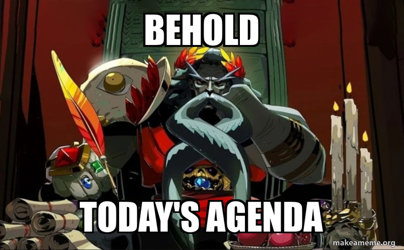

# Cours 10 - Rétroaction, reel et présentation du TP2

## Ordre du jour 

- [Retour sur les présentations]
- [Le reel]
- [Présentation du TP2]
- [Atelier]

## Retour sur les présentation

## Le Reel

[consgignes](./TP1-partie3.md)

### Le paramètrage
Puisque le format de notre vidéo est vertical au lieu d'être horizontal, nous devons donc ajuster les paramètres de notre timeline pour respecter le nouveau format. 

[Capsule paramétrage](https://cmontmorency365-my.sharepoint.com/:v:/g/personal/dominic_roberts_cmontmorency_qc_ca/IQBtkx5DaFf4S7FPfTcOcmyyAfHZudsD2tJNFqzNqglkrag?nav=eyJyZWZlcnJhbEluZm8iOnsicmVmZXJyYWxBcHAiOiJPbmVEcml2ZUZvckJ1c2luZXNzIiwicmVmZXJyYWxBcHBQbGF0Zm9ybSI6IldlYiIsInJlZmVycmFsTW9kZSI6InZpZXciLCJyZWZlcnJhbFZpZXciOiJNeUZpbGVzTGlua0NvcHkifX0&e=TBkl7o){ .md-button }

### La redimension
Puisqu'il y a une différence de format entre la vidéo classique, consommée sur un écran d'ordinateur ou de salon, et la vidéo format court qui est destinée à être consommée sur le téléphone, différentes stratégies doivent être utilisées.  
Si notre sujet ne bouge pas trop, alors un simple ajustement de cadre pour centrer notre sujet peut suffire. Cependant, nous ne voulons pas que la personne sorte du cadre ou soit obstruée par le UI des applications. 

### Le *face tracking*
Si la personne bouge trop et que nous voulons garder son visage bien centré, nous pouvons utiliser le *face tracking* pour garder notre plan bien cadré. 

[Capsule *face tracking*](https://cmontmorency365-my.sharepoint.com/:v:/g/personal/dominic_roberts_cmontmorency_qc_ca/IQC5PrAk36nPRoIiZ71ZtEQ7AVf2L_oZXZuH5O0wgo4CAGE?nav=eyJyZWZlcnJhbEluZm8iOnsicmVmZXJyYWxBcHAiOiJPbmVEcml2ZUZvckJ1c2luZXNzIiwicmVmZXJyYWxBcHBQbGF0Zm9ybSI6IldlYiIsInJlZmVycmFsTW9kZSI6InZpZXciLCJyZWZlcnJhbFZpZXciOiJNeUZpbGVzTGlua0NvcHkifX0&e=dZZtNY){ .md-button }

### Le montage
Puisque le contexte de diffusion est différent d'une vidéo format long qui serait diffusée sur une plateforme comme Youtube, le montage va être différent aussi. Le rythme est un élément qui va être affecté. Plus le format est court, moins on a le temps pour des temps morts où la personne ne parle pas. L'ajout d'une musique d'arrière-plan peut être bénéfique pour ajouter du sensationnalisme et de l'intensité à la vidéo originale. 

### Le *hook*
Commencer avec une phrase choc. L'idée est d'accrocher l'attention du spectateur rapidement pour ne pas qu'il fasse défiler votre vidéo. Souvent, cette phrase peut être la conclusion de la personne qui parle. On la met au début pour accrocher le spectateur, et ensuite on revient un peu en arrière pour mettre tout le clip. 

[Capsule montage](https://cmontmorency365-my.sharepoint.com/:v:/g/personal/dominic_roberts_cmontmorency_qc_ca/IQCWSkkamaMwSqAIEVgasmhwAaYTDyre8ZuoelpnRJBBBdc?nav=eyJyZWZlcnJhbEluZm8iOnsicmVmZXJyYWxBcHAiOiJPbmVEcml2ZUZvckJ1c2luZXNzIiwicmVmZXJyYWxBcHBQbGF0Zm9ybSI6IldlYiIsInJlZmVycmFsTW9kZSI6InZpZXciLCJyZWZlcnJhbFZpZXciOiJNeUZpbGVzTGlua0NvcHkifX0&e=zOgh1l){ .md-button }

### Les sous-titres
L'utilisation de sous-titres qui défilent permet également de capter l'attention de la personne qui regarde la vidéo. Dans le cas d'une vidéo format cours, on veut qu'un mot ou deux apparaissent à la fois pour forcer la personne à lire au même rythme que la personne de la vidéo parle pour maximiser son engagement. Il existe plusieurs méthodes pour générer des sous-titres sur DaVinci. Ces derniers peuvent être générés automatiquement avec DaVinci Studio, mais pas sur la version gratuite. 

[Capsule sous-titres](https://cmontmorency365-my.sharepoint.com/:v:/g/personal/dominic_roberts_cmontmorency_qc_ca/IQAKwi3pNyPIRZKpcJj1eXzuAcZzYmZIxosbJccJTPOW1Nk?nav=eyJyZWZlcnJhbEluZm8iOnsicmVmZXJyYWxBcHAiOiJPbmVEcml2ZUZvckJ1c2luZXNzIiwicmVmZXJyYWxBcHBQbGF0Zm9ybSI6IldlYiIsInJlZmVycmFsTW9kZSI6InZpZXciLCJyZWZlcnJhbFZpZXciOiJNeUZpbGVzTGlua0NvcHkifX0&e=nofvJT){ .md-button }

## Présentation du TP2

[Projet 2 : Partie 1](./TP2-partie1.md){ .md-button }   

[Projet 2 : Partie 2](./TP2-partie2.md){ .md-button }   

[Projet 2 : Partie 3](./TP2-partie3.md){ .md-button }   

## Exemple de projet des années précédentes

[Exemple de projet des années précédentes](https://cmontmorency365-my.sharepoint.com/:f:/g/personal/dominic_roberts_cmontmorency_qc_ca/IgCZKvrUZOUGT4dMKTC8nB8DAapX-cokArHGRrk5cqSIvcc?e=fIgpGq){ .md-button }   

## Exemple de vidéo artistique

[Exemple de vidéo d'art](){ .md-button }   

[Le voyage de la lune (1902) - Georges Méliès](https://peertube.lyceeconnecte.fr/w/qoWHJ2kDz7wrqdKT1g57DL){ .md-button }   

[Das Triadische Ballet (1922) - Oskar Schlemmer](https://vkvideo.ru/video353178_456239239){ .md-button }   

[Ballet Mécanique (1924) - Fernand Léger](https://vimeo.com/816545303){ .md-button }   

[Anémic Cinéma (1926) - Marcel Duchamp](https://vimeo.com/729662411){ .md-button }   

[Walking in an exaggerated manner around the perimeter of a square (1967-68) - Bruce Nauman](https://vimeo.com/576154634){ .md-button }   

[The color of pomegranates (1969) - Sergei Parajanov](https://www.youtube.com/watch?v=gv0Wxaan2MM){ .md-button }   

[Vertical Roll (1972) - Joan Jones](https://www.dailymotion.com/video/x9crft6){ .md-button }   

[Glabal Groove (1973) - Nam June Paik](https://vimeo.com/558372601){ .md-button }   

[Pièce Touchée (1989) - Martin Arnold](https://www.youtube.com/watch?v=AnDagpv4kUk){ .md-button }   

[CNN concatenated (2002) - Omer Fast](https://www.youtube.com/watch?v=aMUWIal6WdU){ .md-button }   

[How not to be seen. A fucking didactic educational .mov file (2013) - Hito Steyerl](https://www.artforum.com/video/hito-steyerl-how-not-to-be-seen-a-fucking-didactic-educational-mov-file-2013-165845/){ .md-button }   

## Travail en classe

- Brainstorm : de manière individuelle, prenez 10 mins pour réfléchir à une idée par sujets proposés
- Sélection : gardez uniquement votre idée préférée et prenez 5 mins pour remplir le tableau suivant 

Titre de travail : ________
L'idée en 1 phrase : ________

| Écran gauche | Écran centre | Écran droit |
|   (idée)  |   (idée)  |  (idée)  |

TV au sol : ________ (gros plan / détail / autre angle)
Lumière : réagit à quoi? ________
Son : 1 son-clé ________
Pourquoi les 3 écrans? ________

- Choix de l'équipe : chaque membre prends une minute pour présenter son idée
- Faire la préprod pour le projet 2 à l'aide du document fournis : [Document de proprod](https://cmontmorency365-my.sharepoint.com/:f:/g/personal/dominic_roberts_cmontmorency_qc_ca/IgB9DohvUSQkRYdMMHHz1jHdAVMAK42OxYyymTdTO1aeg_o?e=1C6dmW)
- Préparer une courte présentation (maximum 2 minutes). Votre présentation doit inclure : 
    - Le synopsis
    - La direction artistique
